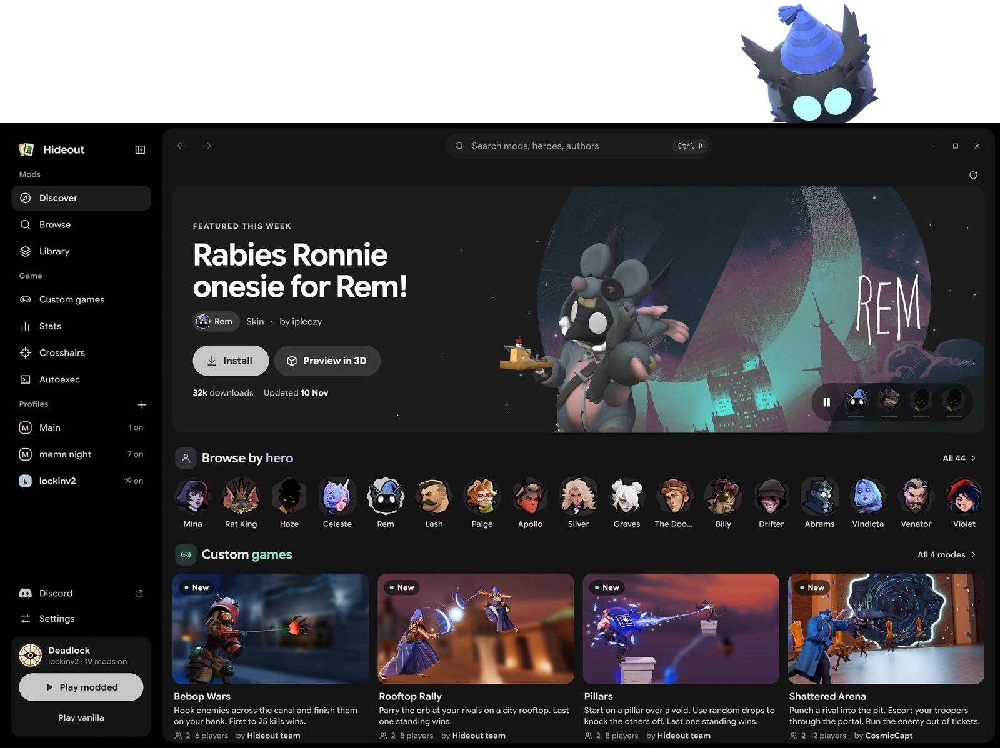
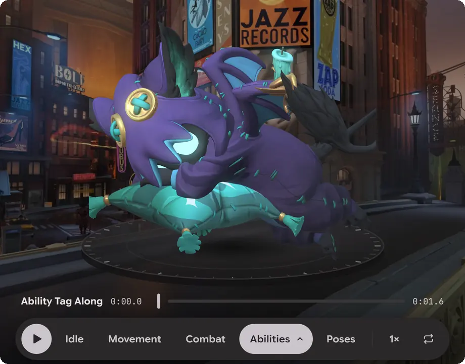
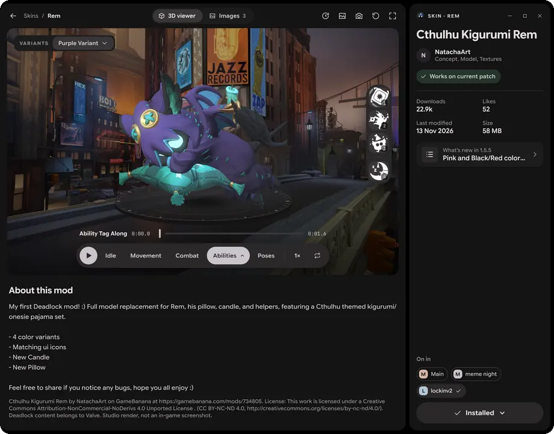
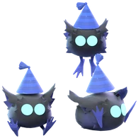

<div align="center">


# Hideout

**Mods and custom games for Deadlock, on Windows and Linux.**

[](LICENSE) [](#download) [](https://hideouthq.gg) [](https://discord.gg/369ndAKXmr)

[Website](https://hideouthq.gg) · [Custom games](https://hideouthq.gg/custom-games) · [Switching from another manager](https://hideouthq.gg/switch) · [Report a bug](https://github.com/hideouthq/hideout/issues)

</div>



Hideout installs Deadlock mods from GameBanana and lets you sort them into profiles, each with its own load order. It also hosts custom games that your friends join with a code.

Hideout is free software under the GPL. It's written in Kotlin with Compose Multiplatform and ships as a native app.

## Custom games with friends

Host a mode on your PC and Hideout gives you a code like `P95-MAN-26D`, plus a link to paste in chat. When a friend opens it, Hideout downloads the mode for them and sends their Deadlock into your game. There's no Hideout account to make or log in to, and nobody types a console command.

Your PC runs the server with [Modlock](https://github.com/paralin/modlock), and [Tailcat](https://github.com/tailscale/tailcat) connects your friends to it, so you don't forward any ports. The modes so far are Bebop Wars, Rooftop Rally, Pillars and Shattered Arena. Their source is in [hideouthq/custom-games](https://github.com/hideouthq/custom-games). Custom games are new and still being tested.

## 3D previews before you install

Open a skin and Hideout shows it in 3D before you download the mod. Drag to turn it, and play its animations and abilities. Skins with variants have a menu to switch between them.

Previews are made ahead of time from each mod's files and packed small: compressed meshes, BC7 textures and zstd over the whole file. The median preview is 7.5 MB, and nothing goes into your game folder until you click **Install**.

<table>
  <tr>
    <td width="50%" align="center" valign="top">
      
      <br><sub>Play a skin's animations and abilities.</sub>
    </td>
    <td width="50%" align="center" valign="top">
      
      <br><sub>The mod's page, with its author and the Install button.</sub>
    </td>
  </tr>
</table>

## Bring your mods from another manager

The first time Hideout opens, it looks for Deadlock Mod Manager and Grimoire. If either one has mods installed, Hideout offers to bring them over with your profiles, crosshair and autoexec commands. Mods keep their load order and their on or off state. You can also run the import later from **Library**.

Hideout takes over the mod files already in your game instead of downloading them again. Then it looks each mod up on GameBanana, so it can update it later. It reads the other manager's settings without changing them, and it backs up `gameinfo.gi` and `autoexec.cfg` before it touches the game folder.

## And the everyday stuff

- **Profiles.** Each profile keeps its own mods turned on and its own load order.
- **File priority.** When two mods change the same files, Hideout lists the files they share and which mod wins. **Move above** swaps them.
- **Skin repairs.** When a Deadlock update breaks a skin, Hideout repairs what it can fix exactly and keeps the original files. This one is experimental.
- **Stats.** Your match history, heroes and rank, from deadlock-api.com.
- **Crosshairs and autoexec.** Pick a crosshair the community made or make your own. Edit `autoexec.cfg` from a library of commands, and the lines you wrote by hand stay.
- **Backups.** A backup puts back your mods, their order, your profiles, `autoexec.cfg` and your crosshair. **Play vanilla** starts Deadlock without your mods.

## Download


Download Hideout for [Windows](https://github.com/hideouthq/hideout/releases/download/v0.1.0/Hideout-0.1.0-Setup.exe) or [Linux](https://github.com/hideouthq/hideout/releases/tag/v0.1.0).

> [!WARNING]
> **Windows gets less testing than Linux.**
>
> I'm mostly on Linux, so that's where Hideout gets tried first. For Windows, I test most things in a Windows VM, or a friend of mine who plays on Windows tries them. A VM isn't a real gaming PC, so some Windows bugs can still get past me. If you hit one, [open an issue](https://github.com/hideouthq/hideout/issues) and say which version of Windows you're on.

## AI assistance

I use a mix of local and cloud AI models to help develop Hideout, including implementation and code reviews. I also use AI extensively to write and run tests on Linux and in a Windows VM. Checks on other Linux distributions include installation and startup tests in containers.

## Build from source

The checked-in `kotlin` wrapper downloads the Kotlin toolchain and the JDK, so there's no Gradle to set up.

```sh
./kotlin run -m desktopApp
./kotlin run -m desktopApp --jvm-args="-Dhideout.data=fake"   # sample data, no network
./kotlin test
```

`ci/test.sh` runs everything CI runs: the Kotlin tests, the link helper's Go tests and the release tools' tests.

Three features need more than the wrapper:

- **Usage statistics** need `HIDEOUT_BUILD_POSTHOG_KEY` at build time. Without it, the app has no analytics service, disclosure, or settings switch. Maintainers store the capture key in Bitwarden and run builds through `with-secrets`. Release jobs require the matching GitHub Actions secret. The key remains readable in compiled builds.
- **3D previews** need the preview host's address and master key at build time. They come from `HIDEOUT_BUILD_PREVIEW_URL` and `HIDEOUT_BUILD_PREVIEW_MASTER`, or from lines with those names in an untracked `preview-build.properties` at the root. The build ships only a key derived from the master for its version, masked under a key generated for that build. A build without them has no previews. Tests and sample data need neither.
- **Custom games** need the `hideout-link` helper. Build it with `go -C tools/link build -o "$PWD/build/hideout-link" .` and set `HIDEOUT_CUSTOMGAMES_HELPER` to that path. Without the helper, custom games don't appear.

<details>
<summary><b>Package the app</b></summary>
<br>

Hideout ships as a GraalVM native image with the Go link helper `hideout-link` beside it.

- **Linux.** `packaging/linux/build.sh` builds the AppImage, DEB and RPM in an AlmaLinux 8 container that holds the whole toolchain, so the binary runs on glibc 2.17 and newer.
- **Windows.** Open MSVC's `vcvars64` shell with GraalVM for JDK 25 at `JAVA_HOME`, and Go and WiX Toolset 3 on `PATH`. Then run `./kotlin.bat do nativePackages -m desktopApp` to build the MSI. It installs for the current user without an administrator prompt.

A `v*` tag runs `.github/workflows/release.yml`, which builds every package and attaches them to a draft release with a signed `releases.json`. Installed packages update themselves from the latest release. Hideout installs an update only when the feed's signature is valid and the package's SHA-256 matches.

</details>

<details>
<summary><b>Repository layout</b></summary>
<br>

| Path | Contents |
| --- | --- |
| `app/shared` | Domain models, repositories, the design system and every screen |
| `app/desktopApp` | The desktop window, file system and audio adapters, the preview cache and the 3D viewer |
| `app/desktopTools` | Rendered screenshot and smoke checks, not shipped |
| `core` | The preview format and its validation |
| `native/steam-bridge` | The opt-in Linux Steam adapters that record match history while Deadlock runs |
| `plugins` | Toolchain plugins for native packaging, the Steam bridge and protobuf code |
| `tools/link` | `hideout-link`, which carries a custom game between host and guests |
| `tools/release` | Cuts a release and writes the signed update feed |

</details>

## Thanks



Special thanks to [Deadlock Mod Manager](https://github.com/deadlock-mod-manager/deadlock-mod-manager) and [Grimoire](https://github.com/Slush97/grimoire). They were here first and made modding Deadlock easier for a lot of players. Hideout imports from both, and its community crosshairs come from Deadlock Mod Manager's shared list.

Hideout also builds on:

- [GameBanana](https://gamebanana.com/games/20948), where the mods and their authors are. Every mod in Hideout is its author's work, and its page in Hideout links back to GameBanana.
- [deadlock-api.com](https://deadlock-api.com), for the match data behind Stats.
- [Modlock](https://github.com/paralin/modlock) by paralin, which runs the custom game servers.
- [Tailcat](https://github.com/tailscale/tailcat) by Tailscale, which carries the connection between a host and their friends.
- [ValveResourceFormat](https://github.com/ValveResourceFormat/ValveResourceFormat), which exports the skin models for the 3D previews.

Hideout is a fan project. It isn't made by or affiliated with Valve, and Deadlock is a trademark of Valve Corporation.

## License

Hideout is free software under the [GNU General Public License v3.0](LICENSE).

As an additional permission under section 7 of the GPL, if you modify Hideout, or any covered work, by linking or combining it with [Junrar](https://github.com/junrar/junrar) (or a modified version of it), which is covered by the UnRAR license, the licensors of Hideout grant you permission to convey the resulting work.

The libraries Hideout bundles keep their own licenses. **Settings › About › Licences** in the app lists each one.
